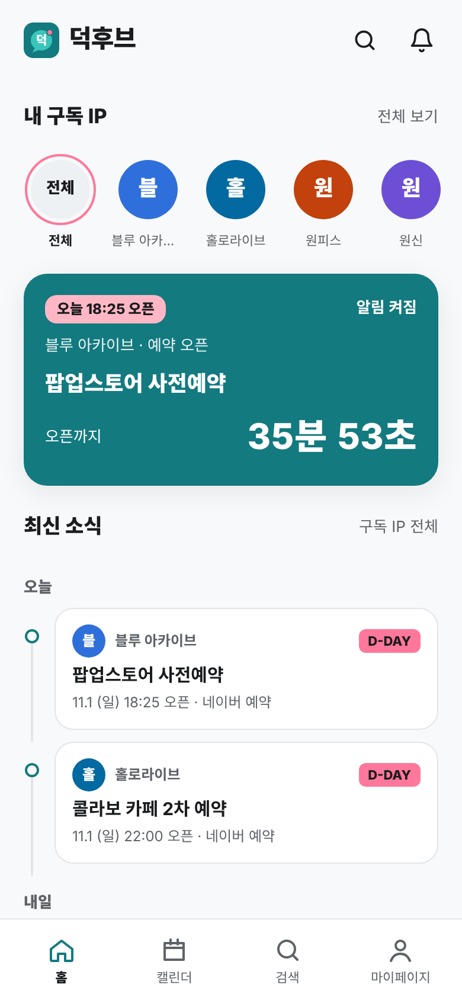
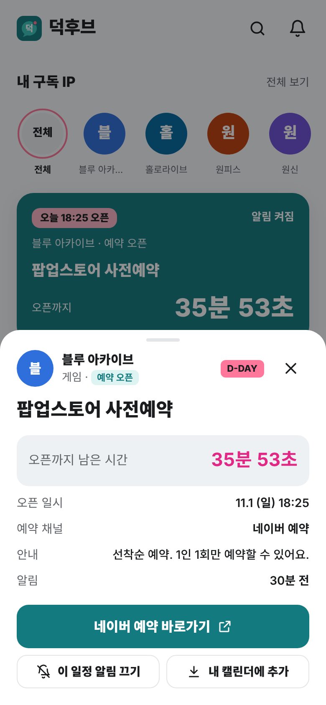
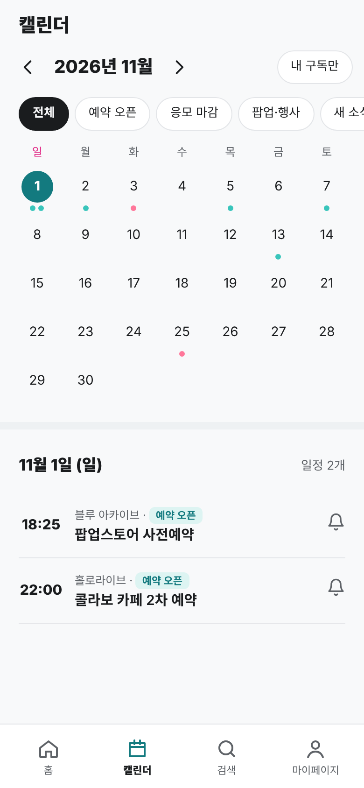
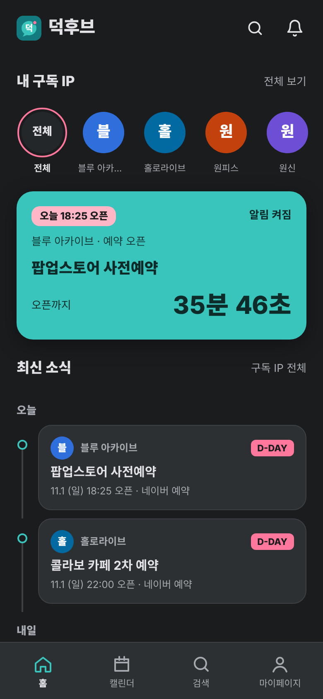

# 덕후브 (DukHub)

> 서브컬처 팬(애니·게임·버튜버·웹툰)을 위한 **예약 오픈 알림 앱**.
> 구독한 작품의 굿즈·팝업·콜라보 카페 예약이 열리기 전에 알려주고, 알림을 누르면 예약 페이지로 바로 이동합니다.

- **📱 웹앱 열기:** `https://아이디.github.io/dukhub/` ← GitHub Pages 주소로 바꿔 주세요
- **🎨 디자인 자료(와이어프레임·시안):** 위 주소 뒤에 `design/`

| 홈 | 일정 상세 | 캘린더 | 다크 모드 |
|---|---|---|---|
|  |  |  |  |

---

## 1. 왜 만드나

- 서브컬처 팬은 X·인스타·카페·공식 홈페이지를 매일 여러 곳 돌아다니며 소식을 모은다.
- 굿즈·팝업 예약은 오픈 시각을 놓치면 품절되거나 리셀가로 사야 한다.
- 설문(n=27) 핵심 불편: **소식 놓침 / 품절·오픈런 / 정보 분산**.

## 2. MVP 기능

| 순서 | 기능 | 앱에서 하는 일 |
|---|---|---|
| ① | IP 구독 | 첫 실행 때 덕질하는 작품 선택, 검색에서 추가·해제 |
| ② | 오픈 일정 확인 | 홈 타임라인(IP명·제목·날짜·D-day), 월간 캘린더 |
| ③ | 오픈 전 알림 | 기본 30분 전 (하루 전·10분 전·정각 추가 선택) |
| ④ | 예약 페이지 바로가기 | 알림·일정 상세에서 예약 페이지로 이동 |

그 밖에: IP별·일정별 알림 끄기, 알림 종류 선택, 방해 금지 시간, 알림함, 내 캘린더에 추가(.ics), 라이트·다크 모드.

## 3. 화면 구성

하단 탭바: **홈 / 캘린더 / 검색 / 마이페이지**

| 화면 | 내용 |
|---|---|
| 온보딩 | 분류별 작품 선택 후 구독 시작 |
| 홈 | 로고 + 검색·알림 아이콘, 구독 IP 가로 목록(누르면 해당 IP만 보기), 다음 오픈 카운트다운, 최신 소식 타임라인 |
| 캘린더 | 월간 달력(일정 점 표시), 종류 필터, 내 구독/전체 전환, 날짜별 일정 |
| 검색 | 이름·별칭 검색(예: 블아, 나혼렙), 분류 필터, 최근 검색어, 오픈 많은 IP 순위 |
| 마이페이지 | 닉네임, 구독·예정 알림·받은 알림 수, 구독 관리, 알림 설정, 알림 기록 |
| 일정 상세 | 남은 시간, 일시·채널·안내, 예약 페이지 바로가기, 이 일정 알림 끄기, 캘린더 추가 |

## 4. 기술 구성

- **HTML·CSS·자바스크립트만 사용** (빌드 과정 없음 → GitHub Pages에 올리면 바로 동작)
- **PWA**: 휴대폰에서 '홈 화면에 추가'하면 앱 아이콘으로 실행, 오프라인에서도 열림
- **저장**: 브라우저 localStorage (구독·알림 설정은 기기별로 저장)
- **알림**: 앱이 열려 있거나 홈 화면 앱이 백그라운드에 있을 때 브라우저 알림으로 표시

| 파일 | 역할 |
|---|---|
| `index.html` | 앱 시작 화면 |
| `app.js` | 화면·기능·알림 로직 |
| `app.css` | 디자인 (민트·핑크 포인트, 라이트·다크 토큰) |
| `data.js` | **작품(IP)·일정 데이터** — 운영자가 직접 입력 |
| `sw.js`, `manifest.webmanifest`, `icons/` | 홈 화면 앱(PWA) 설정 |
| `design/` | 와이어프레임·스타일 시안 |

### 일정 추가하는 법

`data.js`의 `RAW` 목록에 한 줄을 추가합니다.

```js
{ id: 'e30', ip: 'bluearchive', kind: 'open', date: '2026-11-20T20:00', title: '팝업스토어 사전예약', ch: 'naver', url: '실제 예약 페이지 주소', note: '안내 문구' },
```

- `kind`: `open`(예약 오픈) · `deadline`(응모 마감) · `event`(팝업·행사) · `news`(새 소식)
- `ch`: `naver` · `interpark` · `yes24` · `melon`
- 새 작품은 `IPS` 목록에 추가

> 현재 들어 있는 일정은 화면 시연용 예시 데이터입니다. 실제 예약 링크는 일정별 `url`에 넣어 주세요.

## 5. 다음 단계

1. **서버 푸시 알림** — 앱을 완전히 종료해도 알림이 오도록 (Firebase Cloud Messaging 등)
2. **일정 자동 수집** — 공식 X·홈페이지 공지 크롤링/API 연동
3. **계정·동기화** — 여러 기기에서 구독 정보 유지
4. **굿즈 거래마켓** — 중고 안전거래·공동구매 (수수료 3~5% 수익 모델)

## 6. 수익 모델

| 단계 | 모델 | 내용 |
|---|---|---|
| Phase 1 | 무료 | MVP 기간, 유저 확보 (목표: 3개월 내 MAU 1,000명) |
| Phase 2 | 거래 수수료 3% | 굿즈 거래마켓 오픈 (MAU 1,000명 이후) |
| Phase 3 | 수수료 5% + 멤버십 | 월 3,900원 프리미엄 멤버십 (수수료 할인 + 알림 우선 제공) |
