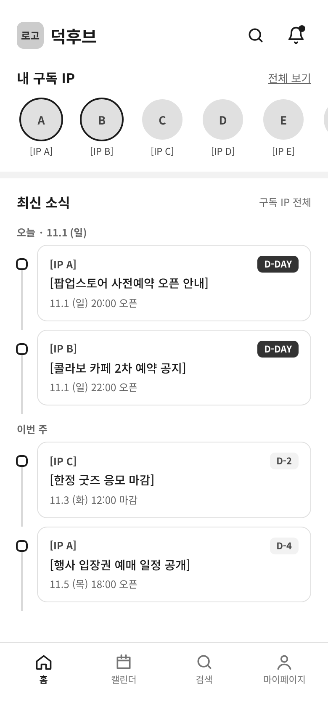
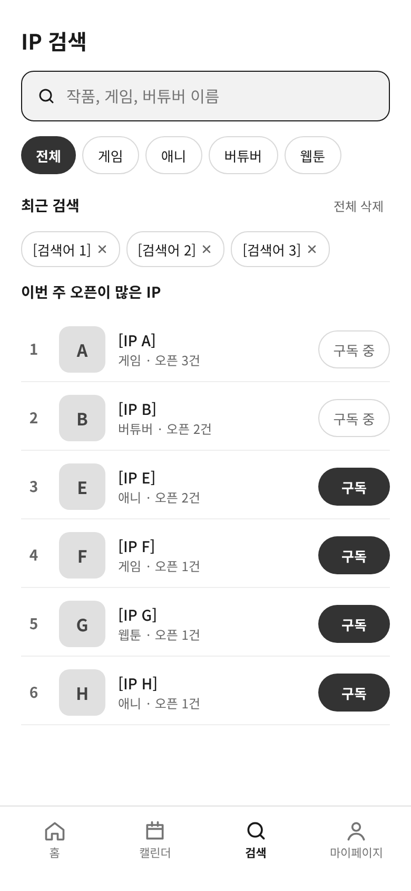
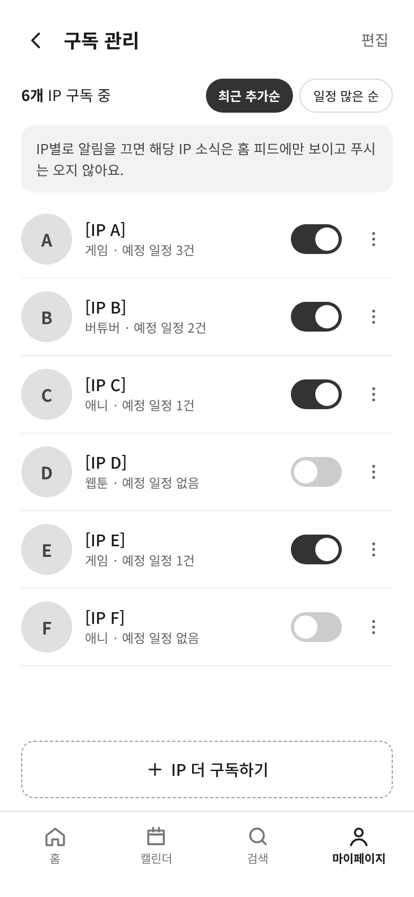
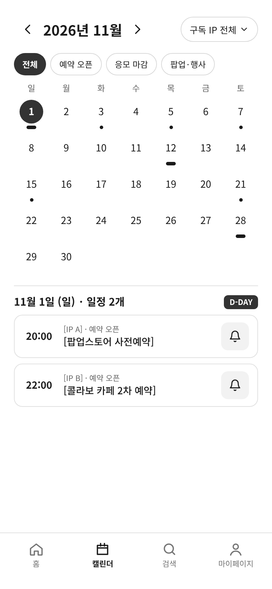
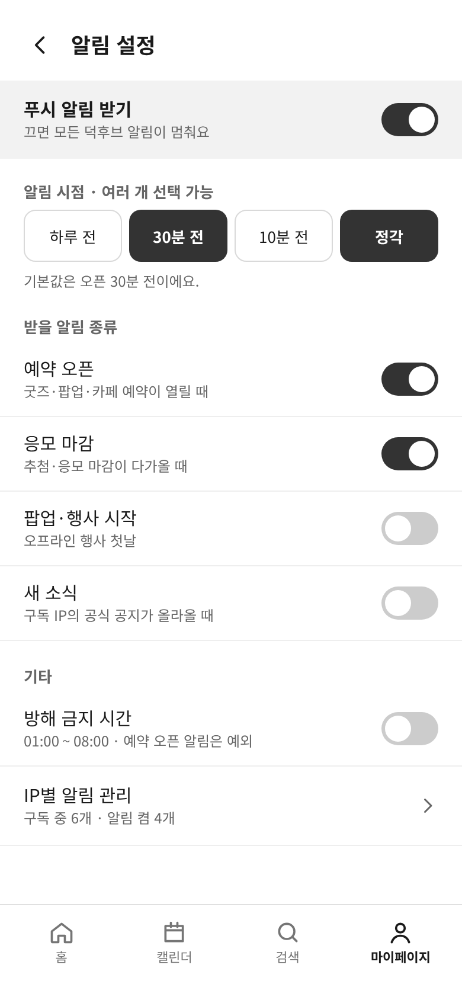
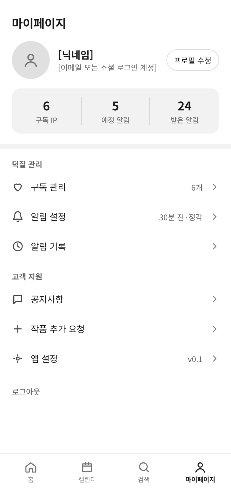
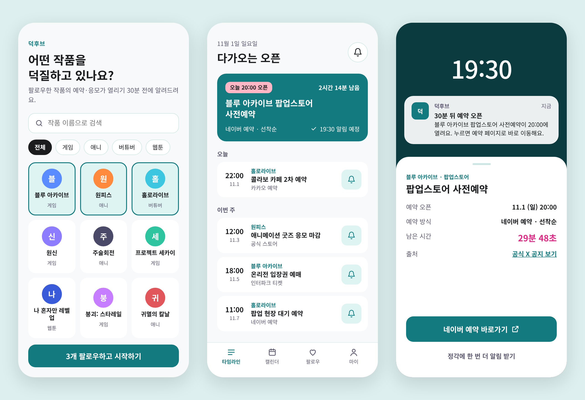
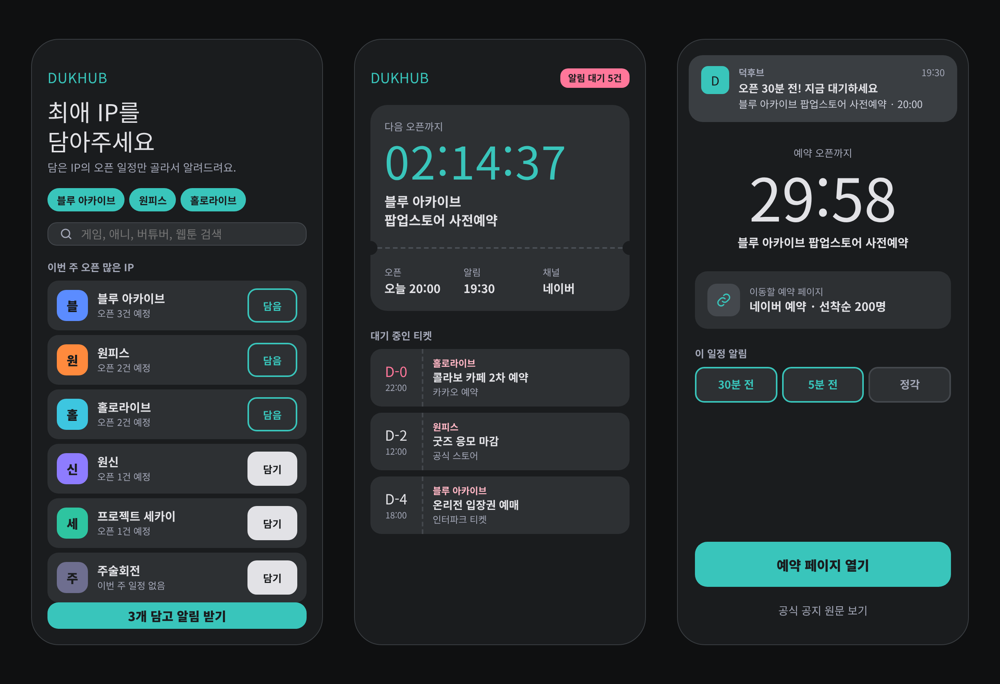
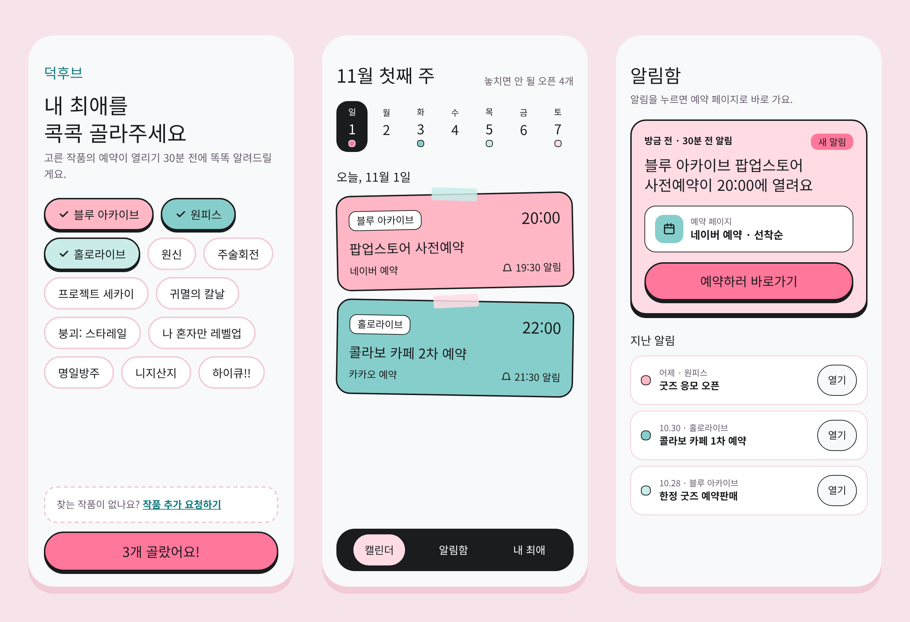

# 덕후브 (DukHub)

> 서브컬처 팬(애니·게임·버튜버·웹툰)의 정보·커뮤니티·굿즈 거래를 한 앱에서.
> Weverse가 K팝에서 한 것을, 서브컬처 전체에서 덕후브가 한다.

**🔗 프로토타입 보기:** GitHub Pages 주소를 여기에 붙여 넣으세요 (예: `https://아이디.github.io/dukhub/`)



---

## 1. 문제

- 서브컬처 팬은 X·인스타·디시·카페·공식 홈페이지를 매일 여러 곳 돌아다니며 소식을 모은다.
- 굿즈·팝업·콜라보 카페 예약은 오픈 시각을 놓치면 품절되거나 리셀가로 사야 한다.
- 기존 앱(서브캔버스·덕쿵·니쿠내쿠)은 일기장·이벤트·지도 중 하나만 다뤄 **올인원 서비스가 없다**.
- 설문(n=27): 열성도 4점 이상 70% 이상, 핵심 불편은 **소식 놓침 / 품절·오픈런 / 정보 분산**.

## 2. 타깃

- 여러 IP를 동시에 즐기는 멀티팬덤 헤비유저 (주당 20시간 이상 덕질)
- 정보 수집에 쓰는 시간을 줄이고 싶은 팬

## 3. MVP — IP 구독 + 예약 오픈 알림

| 순서 | 기능 | 설명 |
|---|---|---|
| ① | IP 구독 | 덕질하는 작품을 골라 구독 |
| ② | 오픈 일정 확인 | 구독한 IP의 예약·응모·팝업 일정을 피드와 캘린더로 확인 |
| ③ | 오픈 30분 전 알림 | 예약·응모가 열리기 30분 전에 푸시 알림 |
| ④ | 예약 페이지 바로가기 | 알림을 누르면 네이버·카카오 예약 등 해당 페이지로 이동 |

- iOS 우선 출시, 초기 IP 20~30개는 직접 데이터 세팅
- 목표: 출시 3개월 내 MAU 1,000명

## 4. 화면 구성

하단 탭바: **홈 / 캘린더 / 검색 / 마이페이지**

| 홈 | IP 검색 | 구독 관리 |
|---|---|---|
|  |  |  |
| 구독 IP 가로 목록, 최신 소식 타임라인(IP명·제목·날짜·D-day) | 검색, 분류 필터, 최근 검색어, 인기 IP 구독 | 구독 IP 목록, IP별 알림 켜기/끄기 |

| 캘린더 | 알림 설정 | 마이페이지 |
|---|---|---|
|  |  |  |
| 월간 달력, 일정 종류 필터, 날짜별 오픈 일정 | 알림 시점(기본 30분 전), 알림 종류, 방해 금지 시간 | 프로필, 구독·알림 요약, 설정 메뉴 |

## 5. 스타일 시안

민트(#39C5BB)·핑크(#FF779A) 팔레트를 적용한 3가지 방향.

**A안 — 오픈 타임라인 (라이트·정보형)**


**B안 — 카운트다운 티켓 (다크·긴장감)**


**C안 — 덕질 다이어리 (파스텔·감성형)**


## 6. 수익 모델

| 단계 | 모델 | 내용 |
|---|---|---|
| Phase 1 | 무료 | MVP 기간, 유저 확보에 집중 |
| Phase 2 | 거래 수수료 3% | 굿즈 거래마켓 오픈 시점(MAU 1,000명 이후) |
| Phase 3 | 수수료 5% + 멤버십 | 월 3,900원 프리미엄 멤버십(수수료 할인 + 알림 우선 제공) |

## 7. 로드맵

1. **1단계 (MVP)** — IP 구독 + 예약 오픈 알림 + 바로가기
2. **2단계** — IP 구독 피드 자동 수집(크롤링·API), IP별 커뮤니티, 덕질 지도
3. **3단계** — 팬 간 굿즈 거래·공동구매(에스크로), 공식 파트너 채널, 한정판 선예약

---

### 폴더 구성

```
index.html      프로토타입 첫 화면 (GitHub Pages에서 열림)
screens/        화면 파일 9개 + support.js(화면을 그려주는 스크립트)
images/         화면 이미지(PNG)
```

※ 화면 속 IP 이름과 일정은 예시 데이터입니다.
